  

  

  
  
  
  

---

### 👋 Bonjour, je suis Hervé

Développeur full-stack et designer à **Abidjan, Côte d’Ivoire**, sous la marque **Grafitt Dev**.
Depuis plus de 5 ans, je construis des applications web et mobiles de bout en bout : la maquette, le code, la base de données et la mise en ligne.

- 💻 **Développement** : Django, React, Vue, Next.js, Node, Laravel
- 🎨 **Design** : UI/UX sous Figma, identités visuelles, affiches, motion design
- 📊 **Données** : SQL, Python (pandas), Power BI, Microsoft Fabric
- 🚀 **Mise en ligne** : Docker, Coolify, Nginx, GitHub Actions, automatisations n8n
- 💳 **Paiement mobile** : intégrations Wave, Orange Money, MTN MoMo et Jèko

### 🧰 Stack

   
  

  
  
  
  
  
  

### 🏗️ Références

| Projet | Ce que j’ai fait | Lien |
|---|---|---|
| **Ton Déj Sharp Sharp** | Plateforme de commande de déjeuners pour les entreprises : paiement mobile, tableau de bord admin, cuisine et livreur | [Voir le site](https://tondej.62.171.162.142.sslip.io) |
| **Mr. CACAO** | Boutique du cacao ivoirien : scènes animées au défilement, commande par WhatsApp, back-office Django | [Voir le site](https://mrcacao.62.171.162.142.sslip.io) |
| **Tabaski Store** | Plateforme d’achat de bétail en ligne pour l’Afrique de l’Ouest | [tabaski.store](https://tabaski.store) |
| **West African Company** | Site du groupe : télécoms, BTP et énergie, demande de devis WhatsApp | [groupwac.com](https://groupwac.com) |
| **JIREH** | Portail RH : recrutement, formations, espace candidats | [jireh-ci.com](https://jireh-ci.com) |
| **SAJ Holding** | Site du groupe et application de gestion d’événements | [sajholding.org](https://sajholding.org) · [sglci](https://sglci.sajholding.org) |
| **Groupe Vivia** | Rebranding, site institutionnel et prototypes d’applications | [viviagroupe-ci.com](https://viviagroupe-ci.com) |
| **Effanus Studio** | Site éditorial d’un photographe, réservation et paiement | [Voir le site](https://effanus.62.171.162.142.sslip.io) |
| **CAMPAY** | Fintech de micro-épargne pour les camps : app mobile Expo, portail Next.js, API Fastify | Privé |
| **Anouanzè** | Plateforme de cotisations et d’appels à projets immobiliers d’une mutuelle | Privé |

Plus de projets, de maquettes et de créations graphiques sur mon <a href="https://portfolio.62.171.162.142.sslip.io">portfolio</a>.

### 📂 Projets publics

  
  
  
  

Grafitt Dev · Abidjan · Ouvert aux missions freelance et aux collaborations

